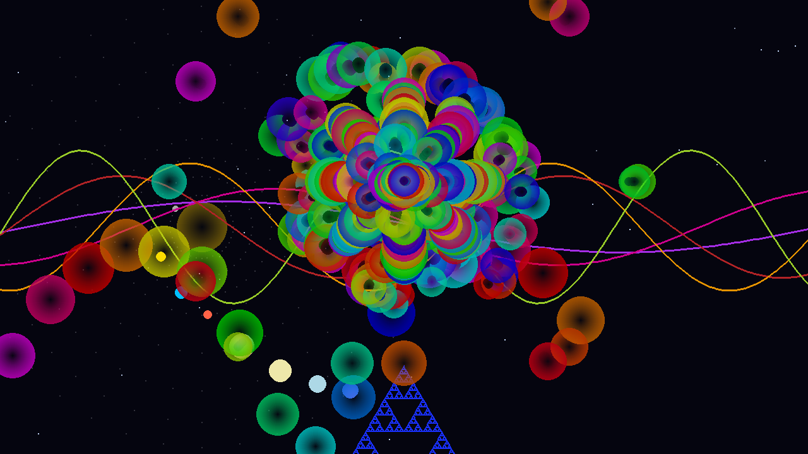

# VoiceArt

[](https://github.com/Imnasir-X/VoiceArt/actions/workflows/ci.yml)
[](https://www.python.org/)
[](LICENSE)

A real-time audio visualiser in Python: your microphone drives bubbles, waves, fractals and an equaliser drawn over an animated solar-system backdrop.



*Frame rendered headlessly from synthetic audio with `scripts/render_preview.py`.*

## Features

- **Live microphone input** captured with PyAudio in a non-blocking callback.
- **Volume and spectrum analysis**: smoothed RMS volume plus 16 log-spaced frequency bands from a windowed FFT.
- **Auto-calibration**: the first three seconds measure the room's noise floor so quiet rooms and loud rooms both respond well.
- **Frequency-driven bubble patterns**: low frequencies spawn spirals, mids spawn starbursts, highs scatter in waves. Bubbles stop spawning when the sound stops.
- **Layered scene**: twinkling star field, orbiting planets, sine waves that swell with volume, an alternating fractal tree / Sierpinski triangle, and a bloom equaliser.
- **Fullscreen, pause and a debug overlay** (FPS, volume, particle count).

## Tech stack

- Python 3.9 to 3.12
- [pygame](https://www.pygame.org/) for rendering
- [NumPy](https://numpy.org/) for FFT and signal maths
- [PyAudio](https://people.csail.mit.edu/hubert/pyaudio/) (PortAudio) for microphone capture

## Quick start

```bash
git clone https://github.com/Imnasir-X/VoiceArt.git
cd VoiceArt
python -m venv .venv
source .venv/bin/activate        # Windows: .venv\Scripts\activate
pip install -r requirements.txt
python main.py
```

PyAudio needs the PortAudio library:

- **Windows**: `pip install PyAudio` installs a prebuilt wheel.
- **macOS**: `brew install portaudio` first.
- **Debian / Ubuntu**: `sudo apt-get install portaudio19-dev` first.

Make some noise during the three-second calibration that runs at start-up, then talk, clap or play music.

## Controls

| Key     | Action                    |
|---------|---------------------------|
| `F`     | Toggle fullscreen         |
| `D`     | Toggle the debug overlay  |
| `Space` | Pause / resume the visuals |
| `Esc`   | Quit                      |

## Development

```bash
pip install -r requirements-dev.txt
ruff check .
pytest -q                                  # headless, no microphone needed
SDL_VIDEODRIVER=dummy python scripts/render_preview.py   # regenerates docs/preview.png
```

## Project structure

```
VoiceArt/
├── main.py               # App window, event loop, keyboard controls, debug overlay
├── audio_capture.py      # PyAudio input stream and callback
├── audio_analysis.py     # RMS volume, FFT bands, calibration, normalisation
├── visualizer.py         # Stars, planets, waves, fractals, equaliser and bubbles
├── scripts/
│   └── render_preview.py # Headless frame renderer for the README image
├── tests/                # Headless smoke tests (pytest)
├── requirements.txt      # Pinned runtime dependencies
└── requirements-dev.txt  # Lint and test tools
```

## License

Released under the [MIT License](LICENSE). Copyright (c) 2026 Nasir Khan.
